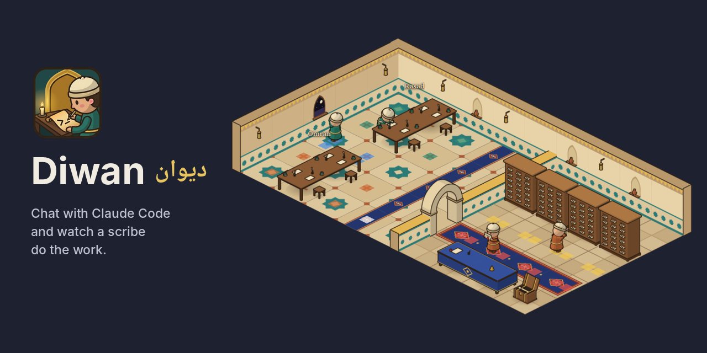

# Diwan

Diwan (ديوان) is a desktop app where you chat with Claude Code and watch a scribe in an old hall do the work. Each
session is a scribe and each project folder gets its own table. The scribe writes at its table, reads in the archive,
goes to the window for web work, waits for you when Claude needs your approval, and goes home when the session ends.

This repository holds the installers and this page only. The source code is not public.

> **Alpha.** Diwan 0.3.1 is a pre-release: expect rough edges and changes between versions.
> **Windows has not been tested on a real Windows machine yet.** The Windows installer is built on a GitHub runner and may
> not work. Linux is the platform it is developed on.

## What you need

- **Linux** x86_64 (developed on Zorin OS 18, an Ubuntu 24.04 based system) or **Windows** 10 / 11, x64 (untested).
- **Claude Code, installed and signed in.** Diwan runs your own Claude Code with your own account. It never asks for,
  reads or stores a password or API key. Claude Code needs a paid Claude plan or an Anthropic Console account.

Nothing else: no Node.js, no settings files, no hooks.

### Install Claude Code (once)

Linux, in a terminal:

    curl -fsSL https://claude.ai/install.sh | bash

Windows, in PowerShell:

    irm https://claude.ai/install.ps1 | iex

Then run `claude` once, sign in in the browser, and quit with `/exit`. If the terminal says `claude` is not found,
open a new terminal. Other ways to install it are in Anthropic's guide: https://code.claude.com/docs/en/setup

## Install Diwan

Download the file for your system from the [Releases](../../releases) page.

- **Debian, Ubuntu, Zorin, Mint:** `Diwan_0.3.1_amd64.deb`, then

      sudo apt install ./Diwan_0.3.1_amd64.deb

- **Other Linux:** `Diwan_0.3.1_amd64.AppImage`, then `chmod +x Diwan_0.3.1_amd64.AppImage` and run it.
  On Ubuntu 24.04 and later AppImages need `sudo apt install libfuse2t64` (on 22.04: `libfuse2`).
- **Windows (untested):** `Diwan_0.3.1_x64-setup.exe`. The installer is not signed, so Windows may say
  "Windows protected your PC": click **More info**, then **Run anyway**. It installs for your user only.

`SHA256SUMS.txt` lists the checksum of every file (`sha256sum -c SHA256SUMS.txt` on Linux).

## First run

1. Open **Diwan** from your app menu (or the Start menu on Windows). If a card says Claude Code is not installed,
   not signed in or needs an update, do what it says and press **Check again**.
2. Press the sessions button at the top of the left rail, then **＋ New session in folder…**, type the full path of a
   project folder (`/home/you/project`, `~/project` or `C:\Users\you\project`) and press **Open**.
3. A scribe walks in and sits at a table named after the folder.
4. Type a message and press **Send**. The scribe moves with what Claude is doing.
5. When Claude wants to run a command, edit a file or fetch a page, Diwan asks you first: press **Allow** or **Deny**.
6. **Stop** interrupts Claude. **End session** closes the session and the scribe leaves.

## What works and what does not

Works today (on Linux):

- Sessions you open inside Diwan, with no setup.
- Finding Claude Code when it is installed in the usual places, even when the app menu does not see your terminal's
  `PATH`.
- A first-run card when Claude Code is missing, signed out or older than the version Diwan was tested with (2.1.310).

Known limits:

- **Sessions you start in a terminal are not shown.** Showing those needs a hook adapter that is a developer tool and
  is not part of the installer.
- **The context bar** (how full Claude's context is) for sessions you open in Diwan updates once, when each reply
  ends, not while Claude is working.
- **Two projects at a time** (the hall has two tables).
- **The folder path is typed.** There is no folder picker yet.
- **The name in your app menu, task bar and installed apps list is "Diwan"**, in English. The window title is «ديوان».
- **Windows is untested** (see above). If you try it, the test checklist is in
  [WINDOWS-TESTING.md](WINDOWS-TESTING.md).
- The interface is in English.

## Privacy

Diwan runs `claude` in the folder you choose, and Claude Code talks to Anthropic exactly as it does in a terminal.
Diwan itself sends nothing over the network: no accounts, no telemetry, no updates check. It listens on
`127.0.0.1:4317` (reachable from this computer only) and keeps its table layout and an event log in its own app data
folder.

## Uninstall

- deb: `sudo apt remove diwan`
- AppImage: delete the file.
- Windows: Settings → Apps → Diwan → Uninstall.

## Reporting problems

Open an issue in this repository with your system, your Claude Code version (`claude --version`) and what you saw.
